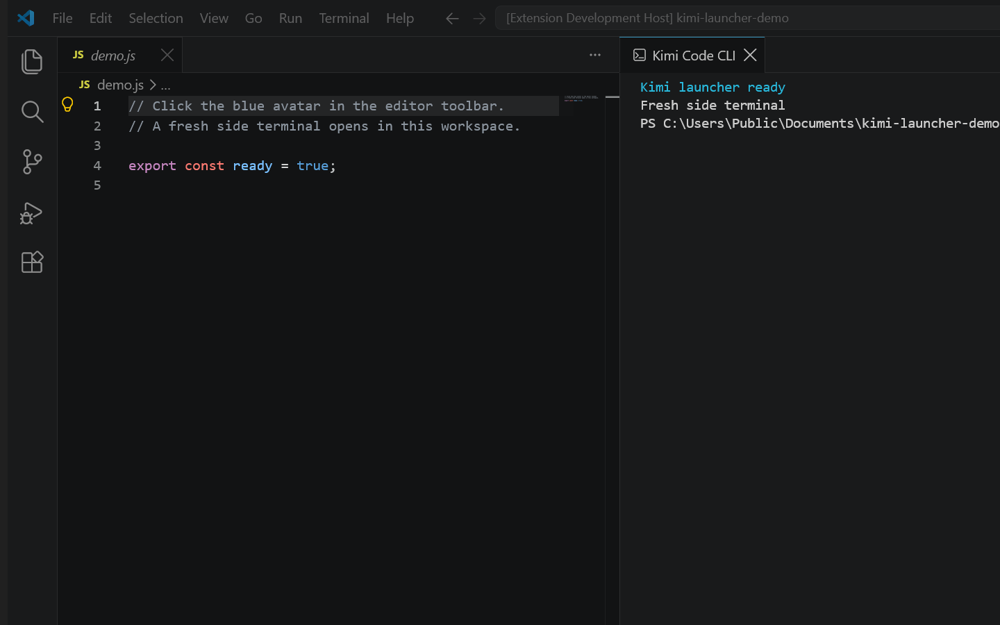

# Kimi Code CLI Launcher

Open Kimi Code CLI in a fresh, workspace-aware side terminal with one click

[](https://github.com/TheStreamCode/vscode-kimi-code-cli-launcher/actions/workflows/ci.yml)
[](LICENSE)
[](https://marketplace.visualstudio.com/items?itemName=mikesoft.vscode-kimi-code-cli-launcher)



Kimi Code CLI Launcher is a lightweight, unofficial VS Code extension that starts `kimi` directly from the editor toolbar. Every click opens a new side terminal in the workspace of the active editor. There is no hidden process, automatic installer, sidebar, terminal-output inspection, or telemetry.

> **Unofficial project.** This extension is unofficial and is not affiliated with, endorsed by, or sponsored by Moonshot AI or Kimi. The Kimi name identifies the compatible CLI only. The luminous blue avatar is an independent redraw for this launcher, not an official Kimi asset. See [`TRADEMARKS.md`](TRADEMARKS.md).

The screenshot is a real VS Code Extension Host capture. The terminal text uses a harmless demo command; the launcher never inspects terminal output.

## Install

### VS Code Marketplace

Search for **Kimi Code CLI Launcher**, open the [Marketplace listing](https://marketplace.visualstudio.com/items?itemName=mikesoft.vscode-kimi-code-cli-launcher), or run:

```bash
code --install-extension mikesoft.vscode-kimi-code-cli-launcher
```

### Open VSX

VSCodium, Cursor, Windsurf, and other editors backed by Open VSX can install the same extension id from the [Open VSX listing](https://open-vsx.org/extension/mikesoft/vscode-kimi-code-cli-launcher).

### VSIX from a GitHub release

Download `vscode-kimi-code-cli-launcher-<version>.vsix` and its `.sha256` checksum from the [latest GitHub release](https://github.com/TheStreamCode/vscode-kimi-code-cli-launcher/releases/latest), then run:

```bash
code --install-extension vscode-kimi-code-cli-launcher-<version>.vsix
```

You can also use **Extensions: Install from VSIX...** from the Command Palette.

## Quick start

1. Install Kimi Code CLI from the [official getting-started guide](https://www.kimi.com/code/docs/en/kimi-code-cli/guides/getting-started.html).
2. Confirm that `kimi --version` works in a regular integrated terminal.
3. Install Kimi Code CLI Launcher from the Visual Studio Marketplace or Open VSX.
4. Open a project file and click the blue avatar in the editor toolbar.

Each click starts an independent Kimi Code CLI session in a new side terminal.

## Features

- One-click access from the editor title toolbar
- A fresh side terminal for every session
- Active-editor workspace selection, with the first workspace as fallback
- User-level-only command configuration; workspace values are ignored
- Workspace Trust enforced even for programmatic command invocation
- Quoted Windows executable paths are preserved
- No runtime dependencies, installers, downloads, hidden processes, or telemetry
- Windows, macOS, and Linux support through standard VS Code APIs

## Requirements

- VS Code `^1.103.0` or a compatible editor
- Kimi Code CLI available in the integrated terminal environment
- Git for Windows before the first Kimi launch on Windows

Use the [official Kimi Code CLI guide](https://www.kimi.com/code/docs/en/kimi-code-cli/guides/getting-started.html) for current installation instructions. The official npm alternative requires Node.js 22.19.0 or later:

```bash
npm install -g @moonshot-ai/kimi-code
kimi --version
```

On Windows, Kimi uses the Git Bash bundled with Git for Windows. If Git Bash is installed in a custom location, set `KIMI_SHELL_PATH` to the absolute path of `bash.exe`.

This extension does not install Kimi Code CLI or modify shell configuration. The official Kimi update command is `kimi upgrade`. For the difference between this terminal launcher and the official editor extension, see [`docs/FAQ.md`](docs/FAQ.md).

## Configuration

| Setting | Purpose | Default | Scope |
| --- | --- | --- | --- |
| `kimiCodeCliLauncher.cliCommand` | Command sent to the new terminal. Workspace values are intentionally ignored. | `kimi` | User/machine |
| `kimiCodeCliLauncher.terminalName` | Base label for new terminals. | `Kimi Code CLI` | Window |

Open **Kimi Code CLI Launcher: Open Settings** from the Command Palette.

```json
"kimiCodeCliLauncher.cliCommand": "kimi"
```

For a Windows executable path containing spaces:

```json
"kimiCodeCliLauncher.cliCommand": "\"C:\\Program Files\\Kimi Code\\kimi.exe\""
```

Treat the setting as executable code: review it before use and never place API keys or other secrets in it. The launcher reads no `.env` files or credentials. New terminals inherit the environment supplied by VS Code; Kimi owns its own login and provider configuration.

## Privacy and security

The launcher does not collect telemetry, analytics, or personal data. It does not install software, create temporary scripts, inspect terminal output, access the network, or invoke hidden child processes.

The launch command is resolved from user-level configuration only, and the extension checks `workspace.isTrusted` at execution time, so invoking the command programmatically cannot bypass Workspace Trust. The configured command is sent visibly to the integrated terminal only after trust is granted.

See [`SECURITY.md`](SECURITY.md) and the dated [security review](docs/SECURITY_REVIEW.md).

## Troubleshooting

### The terminal opens but `kimi` is not recognized

Confirm that `kimi --version` works in a regular integrated terminal. If Kimi was installed while VS Code was open, restart the editor so new terminals inherit the updated `PATH`.

### Kimi cannot find Git Bash on Windows

Install Git for Windows. For a non-default installation, set `KIMI_SHELL_PATH` to the absolute path of `bash.exe`, then restart VS Code.

### The toolbar action does not run in Restricted Mode

The launcher intentionally refuses to send terminal commands until the workspace is trusted. Review the workspace contents and configured command before granting trust.

### Multi-root workspaces

Open a file from the target workspace before clicking the launcher. The active editor determines the preferred working directory.

## Development

Requirements: Node.js 22 and npm with the committed `package-lock.json`.

```bash
git clone https://github.com/TheStreamCode/vscode-kimi-code-cli-launcher.git
cd vscode-kimi-code-cli-launcher
npm ci --ignore-scripts
npm run check
npm run check:security
```

`npm run check` runs the linter, formatter check, type check, unit and metadata tests, the VS Code Extension Host smoke test, and the packaged file list. `npm run check:security` runs the high-severity dependency audit used by CI. See [`CONTRIBUTING.md`](CONTRIBUTING.md) for the full local workflow and release procedure.

## Support

Open a GitHub issue for reproducible bugs and feature requests, or read [`SUPPORT.md`](SUPPORT.md) for the information to include. Usage questions can also be asked in GitHub Discussions. Maintenance can be supported through [GitHub Sponsors](https://github.com/sponsors/TheStreamCode).

## Contributing

See [`CONTRIBUTING.md`](CONTRIBUTING.md). Pull requests must pass the required CI checks.

## License

MIT License — see [`LICENSE`](LICENSE).

---

Maintained by [Michael Gasperini (Mikesoft)](https://mikesoft.it).
If this project is useful to you, consider [sponsoring its maintenance](https://github.com/sponsors/TheStreamCode).
